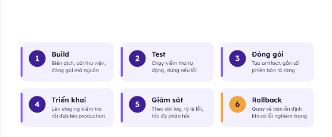

# Deploy dự án Backend (Spring Boot) lên VPS

## Mục lục

1. [Tổng quan Deploy](#1-tổng-quan-deploy)
2. [VPS và SSH](#2-vps-và-ssh)
3. [Docker](#3-docker)
4. [Network: IP, Port, Firewall](#4-network-ip-port-firewall)
5. [DNS và Proxy](#5-dns-và-proxy)
---

## 1. Tổng quan Deploy

### 1.1. Deploy là gì?

**Deploy (triển khai)** là quá trình đưa ứng dụng từ môi trường phát triển (máy cá nhân của developer) lên một môi trường chạy thật (server) để người dùng hoặc các hệ thống khác có thể truy cập qua mạng.

Ví dụ: `http://localhost:8080/api/hello`. Sau khi deploy, mọi người có thể truy cập `https://api.example.com/api/hello`.

### 1.2. Các môi trường thường gặp

| Môi trường | Tên gọi | Mục đích |
|---|---|---|
| Local / Dev | Development | Developer code và chạy thử trên máy cá nhân |
| Test / Staging | Staging | Tester kiểm thử chức năng, phát hiện lỗi. Staging Mô phỏng gần giống production để kiểm tra lần cuối.|
| Production | Production | Môi trường thật, người dùng thật sử dụng |

### 1.3. Quy trình các bước khi deploy một dự án BE



| Bước | Mô tả |
|---|---|
| 1. Chuẩn bị server | Có VPS, cài OS, cài Docker, mở port cần thiết | 
| 2. Build | Biên dịch code, chạy test, tạo file chạy được | 
| 3. Đóng gói | Đóng gói app cùng môi trường chạy |
| 4. Đưa lên server | Chuyển artifact/source lên VPS |
| 5. Cấu hình | Biến môi trường, database, secret |
| 6. Chạy | Khởi động ứng dụng |
| 7. Mở truy cập | Mở port, cấu hình domain, reverse proxy, HTTPS |
| 8. Kiểm tra | Xác nhận app hoạt động | 
| 9. Giám sát & cập nhật | Xem log, theo dõi tài nguyên, release bản mới |

### 1.4. Các hình thức deploy phổ biến 

- **Thủ công trên VPS** : tự SSH vào server và chạy lệnh.
- **Deploy bằng Docker / Docker Compose** (: đóng gói app thành container, dễ tái lập môi trường.
- **CI/CD** (GitHub Actions, GitLab CI, Jenkins): tự động build, test, deploy khi push code. 
- **PaaS** (Heroku, Railway, Render): chỉ cần đẩy code, nền tảng lo phần còn lại.
- **Cloud / Orchestration** (AWS, GCP, Kubernetes): dành cho hệ thống lớn.

---

## 2. VPS và SSH

### 2.1. VPS là gì?

**VPS (Virtual Private Server)** là máy chủ ảo, bóc tách khái niệm này cho bạn: Server là một máy chủ có hiệu năng mạnh mẽ lưu trữ tất cả tệp tin cần thiết cho website của bạn. Tiếp đến khía cạnh virtual (ảo): VPS sử dụng công nghệ ảo hoá để phân chia máy chủ vật lý thành nhiều máy chủ ảo. Hãy tưởng tượng ra đó là một thiết bị vật lý nhưng hoạt động như nhiều máy chủ riêng biệt. Từ “private” (riêng tư) mang chính xác ý nghĩa của nó. Máy chủ ảo được dành riêng cho bạn, bạn sẽ không phải chia sẻ RAM, CPU hoặc bất kỳ dữ liệu nào với người dùng khác. Hiểu đơn giản, VPS giống như một máy tính cá nhân của bạn trong môi trường ảo hoá.

VPS được sử dụng cho nhiều mục đích :

* Lưu trữ và vận hành website, blog, diễn đàn.
* Làm máy chủ game, máy chủ email, VPN, proxy.
* Lưu trữ, sao lưu dữ liệu cá nhân/doanh nghiệp.
* Phát triển, thử nghiệm phần mềm và ứng dụng.
* Chạy các dịch vụ web, thương mại điện tử, livestream.

Thông tin thường nhận được khi thuê VPS: **địa chỉ IP**, **username** (thường là `root` hoặc `ubuntu`), **mật khẩu** hoặc **file private key** (`.pem`).


### 2.2. SSH là gì?

**SSH (Secure Shell)** là giao thức mạng cho phép **kết nối và điều khiển máy từ xa một cách an toàn** (dữ liệu được mã hóa). Mặc định SSH chạy ở **port 22**.

Chức năng chính của SSH:

* **Truy cập và điều khiển từ xa:** Cho phép gõ lệnh và quản trị máy chủ (VPS, Linux server, cloud server) từ terminal mà không cần tiếp cận trực tiếp thiết bị.
* **Truyền tệp tin an toàn:** Hỗ trợ chuyển đổi dữ liệu thông qua các giao thức như SCP hoặc SFTP.
* **Xác thực Git:** Dùng để đẩy (push) hoặc kéo (pull) mã nguồn một cách an toàn lên các nền tảng như GitHub hoặc GitLab.
* **Tạo SSH Tunnel:** Chuyển tiếp cổng (port forwarding) để truy cập các dịch vụ nội bộ an toàn.

Có hai cách xác thực:

| Cách | Mô tả | Đánh giá |
|---|---|---|
| **Password** | Nhập mật khẩu của user | Đơn giản nhưng dễ bị dò mật khẩu  |
| **SSH Key** (public/private key) | Private key giữ ở máy bạn, public key đặt trên server | An toàn hơn, dùng cho production |

### 2.3. Cách kết nối VPS qua SSH

**Cú pháp:**

```bash
ssh <username>@<ip_hoặc_domain>
ssh -p <port> <username>@<ip>          # nếu SSH không dùng port 22
ssh -i /đường/dẫn/key.pem <username>@<ip>   # kết nối bằng private key
```

**Ví dụ:**

```bash
ssh root@203.0.113.10
ssh -i ~/.ssh/my-vps.pem ubuntu@203.0.113.10
```


**Tạo SSH key và đưa public key lên server:**

```bash
# 1. Tạo cặp key trên máy
ssh-keygen -t ed25519 -C "email-cua-ban@example.com"

# 2. Copy public key lên server
ssh-copy-id ubuntu@203.0.113.10

# 3. Từ giờ đăng nhập không cần mật khẩu
ssh ubuntu@203.0.113.10
```

**Một số lỗi thường gặp:**

| Lỗi | Nguyên nhân thường gặp |
|---|---|
| `Connection timed out` | Sai IP, VPS tắt, firewall chặn port 22 |
| `Connection refused` | Dịch vụ SSH chưa chạy hoặc sai port |
| `Permission denied (publickey)` | Sai user, sai key hoặc key chưa được thêm vào server |
| `UNPROTECTED PRIVATE KEY FILE` | File key quá quyền, sửa bằng `chmod 400 key.pem` |

### 2.4. Một số lệnh Linux cơ bản

**Điều hướng và quản lý file**

| Lệnh | Ý nghĩa | Ví dụ |
|---|---|---|
| `pwd` | Hiển thị thư mục hiện tại | `pwd` |
| `ls` | Liệt kê file | `ls -la` (hiện cả file ẩn, chi tiết) |
| `cd` | Chuyển thư mục | `cd /home/ubuntu`, `cd ..`, `cd ~` |
| `mkdir` | Tạo thư mục | `mkdir -p app/logs` |
| `touch` | Tạo file rỗng | `touch .env` |
| `cp` | Copy | `cp app.jar app-backup.jar`, `cp -r dir1 dir2` |
| `mv` | Di chuyển / đổi tên | `mv old.txt new.txt` |
| `rm` | Xóa (**cẩn thận, không có thùng rác**) | `rm file.txt`, `rm -rf folder` |

**Xem và sửa nội dung file**

| Lệnh | Ý nghĩa | Ví dụ |
|---|---|---|
| `cat` | In nội dung file | `cat docker-compose.yml` |
| `less` | Xem file dài (thoát bằng `q`) | `less app.log` |
| `head` / `tail` | Xem đầu / cuối file | `tail -n 100 app.log` |
| `tail -f` | Theo dõi log realtime (thoát `Ctrl+C`) | `tail -f app.log` |
| `nano` | Trình soạn thảo dễ dùng (`Ctrl+O` lưu, `Ctrl+X` thoát) | `nano .env` |
| `vim` | Trình soạn thảo mạnh (`i` để sửa, `Esc` rồi `:wq` để lưu và thoát) | `vim .env` |
| `grep` | Tìm chuỗi trong file | `grep "ERROR" app.log` |

**Quyền, người dùng**

| Lệnh | Ý nghĩa | Ví dụ |
|---|---|---|
| `sudo` | Chạy lệnh với quyền admin | `sudo apt update` |
| `chmod` | Đổi quyền file | `chmod +x run.sh`, `chmod 400 key.pem` |
| `chown` | Đổi chủ sở hữu | `sudo chown -R ubuntu:ubuntu /home/ubuntu/app` |
| `whoami` | Xem user hiện tại | `whoami` |

**Hệ thống và tiến trình**

| Lệnh | Ý nghĩa | Ví dụ |
|---|---|---|
| `apt update && apt upgrade` | Cập nhật gói (Ubuntu/Debian) | `sudo apt update && sudo apt upgrade -y` |
| `apt install` | Cài phần mềm | `sudo apt install -y git curl nginx` |
| `ps aux` | Liệt kê tiến trình | `ps aux \| grep java` |
| `top` / `htop` | Xem CPU/RAM theo thời gian thực | `htop` |
| `kill` | Dừng tiến trình theo PID | `kill -9 1234` |
| `df -h` | Xem dung lượng ổ đĩa | `df -h` |
| `free -h` | Xem RAM | `free -h` |
| `systemctl` | Quản lý dịch vụ | `sudo systemctl status nginx`, `restart`, `enable` |
| `journalctl` | Xem log hệ thống | `sudo journalctl -u nginx -f` |

**Mạng**

| Lệnh | Ý nghĩa | Ví dụ |
|---|---|---|
| `curl` | Gửi HTTP request | `curl http://localhost:8080/api/hello` |
| `wget` | Tải file | `wget https://example.com/file.zip` |
| `ping` | Kiểm tra kết nối | `ping google.com` |
| `ss -tulpn` | Xem port đang lắng nghe | `sudo ss -tulpn \| grep 8080` |
| `ip a` | Xem địa chỉ IP của máy | `ip a` |


---

## 3. Docker

### 3.1. Docker là gì?

**Docker** là nền tảng cho phép **đóng gói ứng dụng cùng toàn bộ môi trường chạy** (JDK, thư viện, cấu hình...) vào một đơn vị gọi là **container**, để chạy nhất quán trên mọi máy.

**Vấn đề Docker giải quyết:** "Chạy được trên máy tôi nhưng lên server thì lỗi" (khác phiên bản Java, thiếu thư viện, khác cấu hình...).


### 3.2. Các khái niệm cốt lõi

| Khái niệm | Giải thích | So sánh dễ hiểu |
|---|---|---|
| **Image** | Bản mẫu **chỉ đọc**, chứa app + môi trường. Được tạo từ Dockerfile. | Như file cài đặt / bản thiết kế / class trong Java |
| **Container** | Một **thể hiện đang chạy** của image. Một image có thể tạo ra nhiều container. | Như tiến trình đang chạy / object trong Java |
| **Dockerfile** | File văn bản chứa các chỉ thị để **build ra image**. | Công thức nấu ăn |
| **Docker Compose** | Công cụ định nghĩa và chạy **nhiều container cùng lúc** bằng file `docker-compose.yml`. | Bản điều phối cả dàn nhạc (app + DB + Redis...) |
| **Registry** | Nơi lưu trữ và chia sẻ image (Docker Hub, GHCR, AWS ECR...). | Như GitHub nhưng cho image |
| **Volume** | Nơi lưu dữ liệu **bền vững** bên ngoài container (vì container xóa là mất dữ liệu bên trong). | Ổ đĩa gắn ngoài |
| **Network** | Mạng ảo để các container nói chuyện với nhau (gọi nhau bằng tên service). | Mạng LAN nội bộ |

Luồng cơ bản:

```
Dockerfile --(docker build)--> Image --(docker run)--> Container
                                  │
                       (docker push / pull)
                                  │
                              Registry
```


### 3.3. Các lệnh Docker thường dùng

**Cài Docker trên Ubuntu** (cách nhanh, dùng script chính thức):

```bash
curl -fsSL https://get.docker.com | sudo sh
sudo usermod -aG docker $USER     # cho phép chạy docker không cần sudo (đăng xuất, đăng nhập lại)
docker --version
docker compose version
```

**Image**

```bash
docker build -t demo-app:1.0 .      # build image từ Dockerfile ở thư mục hiện tại
docker images                       # liệt kê image
docker pull nginx:latest            # tải image từ registry
docker rmi <image_id>               # xóa image
```

**Container**

```bash
docker run -d --name demo -p 8080:8080 demo-app:1.0   # chạy nền, map port
docker ps                           # container đang chạy
docker ps -a                        # tất cả container (cả đã dừng)
docker logs -f demo                 # xem log realtime
docker exec -it demo bash           # vào bên trong container
docker stop demo                    # dừng
docker start demo                   # chạy lại
docker restart demo
docker rm demo                      # xóa container (đã dừng)
```

Ý nghĩa tham số `-p 8080:8080`: `-p <port_máy_chủ>:<port_container>`. Ví dụ `-p 80:8080` nghĩa là truy cập port 80 của VPS sẽ chuyển vào port 8080 trong container.

**Docker Compose**

```bash
docker compose up -d                # chạy toàn bộ service ở chế độ nền
docker compose up -d --build        # build lại image rồi chạy (dùng khi có code mới)
docker compose ps                   # trạng thái các service
docker compose logs -f app          # log của service "app"
docker compose down                 # dừng và xóa container (giữ volume)
docker compose down -v              # xóa cả volume (MẤT dữ liệu DB!)
```

**Dọn dẹp**

```bash
docker system prune -a              # xóa image/container không dùng (cẩn thận)
docker system df                    # xem dung lượng Docker đang chiếm
```

---

## 4. Network: IP, Port, Firewall

### 4.1. Địa chỉ IP

**IP (Internet Protocol address)** là địa chỉ định danh một thiết bị trong mạng, giống "số nhà" để tìm đến đúng máy.

| Loại | Ví dụ | 
|---|---|
| **IPv4** | `203.0.113.10` | 
| **IPv6** | `2001:db8::1` | 
| **Public IP** | `203.0.113.10` |
| **Private IP** | `192.168.x.x`, `10.x.x.x`, `172.16–31.x.x` | 
| **Loopback** | `127.0.0.1` (`localhost`) | T
| **`0.0.0.0`** | 

### 4.2. Port

**Port (cổng)** là số từ **0 đến 65535** để phân biệt các ứng dụng/dịch vụ chạy trên cùng một máy. IP là "số nhà", **port là "số phòng"**.

Cú pháp truy cập: `http://<IP>:<PORT>`, ví dụ `http://203.0.113.10:8080`.

- Port **0–1023**: well-known ports (cần quyền root để bind).
- Port **1024–49151**: registered ports.
- Port **49152–65535**: dynamic/ephemeral ports.
- Mỗi port tại một thời điểm chỉ một tiến trình được lắng nghe (nếu trùng sẽ báo lỗi `Port already in use`).

### 4.3. Các port thường gặp trong một dự án

| Port | Dịch vụ | Ghi chú |
|---|---|---|
| **22** | SSH | Điều khiển server từ xa |
| **80** | HTTP | Web không mã hóa |
| **443** | HTTPS | Web có mã hóa (SSL/TLS) |
| **8080** | Spring Boot / Tomcat | Port mặc định của Spring Boot (`server.port`) |
| **3000** | Node.js / React dev | Thường dùng ở frontend |
| **5173** | Vite dev server | Frontend |
| **3306** | MySQL / MariaDB | Database |
| **5432** | PostgreSQL | Database |
| **1433** | SQL Server | Database |
| **27017** | MongoDB | Database |
| **6379** | Redis | Cache |
| **5672** | RabbitMQ (AMQP) | Message broker |
| **15672** | RabbitMQ Management UI | Giao diện quản trị |
| **9092** | Apache Kafka | Message broker |
| **9200** | Elasticsearch | Tìm kiếm |
| **25 / 465 / 587** | SMTP | Gửi mail |
| **9090** | Prometheus | Monitoring |

> **Nguyên tắc bảo mật:** Chỉ mở ra Internet những port **thật sự cần** (22, 80, 443). Port database (3306, 5432, 6379...) **không nên mở public**; để app và DB nói chuyện với nhau trong mạng nội bộ Docker.

### 4.4. Firewall

**Firewall (tường lửa)** là lớp kiểm soát lưu lượng mạng vào/ra server dựa trên các quy tắc (cho phép hoặc chặn theo IP, port, giao thức).

Có hai tầng firewall cần để ý:

1. **Firewall của nhà cung cấp VPS** (Security Group, Cloud Firewall...): cấu hình trong trang quản trị. Trên AWS/GCP/Azure **phải mở port tại đây**, nếu không thì bên trong có mở cũng không truy cập được.
2. **Firewall trên chính hệ điều hành**: `ufw` (Ubuntu) hoặc `firewalld`/`iptables`.

**Dùng UFW trên Ubuntu:**

```bash
sudo ufw allow OpenSSH        # hoặc: sudo ufw allow 22/tcp  (LÀM TRƯỚC khi bật ufw để khỏi tự khóa mình!)
sudo ufw allow 80/tcp
sudo ufw allow 443/tcp
sudo ufw enable               # bật firewall
sudo ufw status verbose       # xem trạng thái
sudo ufw delete allow 8080/tcp   # xóa một quy tắc
```

---

## 5. DNS và Proxy

### 5.1. Domain và DNS

- **Domain (tên miền):** tên dễ nhớ thay cho địa chỉ IP, ví dụ `example.com`, `api.example.com`.
- **DNS (Domain Name System):** hệ thống "danh bạ" của Internet, **chuyển tên miền thành địa chỉ IP**.

Luồng hoạt động khi truy cập `api.example.com`:

```
Trình duyệt → hỏi DNS "api.example.com là IP nào?"
            ← DNS trả lời "203.0.113.10"
Trình duyệt → gửi request tới 203.0.113.10 (port 80/443)
```

**Các loại bản ghi DNS thường dùng:**

| Bản ghi | Ý nghĩa | Ví dụ |
|---|---|---|
| **A** | Trỏ tên miền về địa chỉ **IPv4** | `api.example.com → 203.0.113.10` |
| **AAAA** | Trỏ tên miền về **IPv6** | |
| **CNAME** | Bí danh, trỏ tên miền này sang tên miền khác | `www → example.com` |
| **MX** | Máy chủ nhận mail | |
| **TXT** | Văn bản (xác thực domain, SPF, DKIM...) | |
| **NS** | Name server quản lý tên miền | |

**Quy trình gắn domain vào VPS:**

1. Mua domain (Namecheap, GoDaddy, Cloudflare, Mắt Bão, PA Vietnam...).
2. Vào trang quản lý DNS, tạo bản ghi **A** trỏ về IP public của VPS.
3. Chờ DNS cập nhật (vài phút đến vài giờ - gọi là *propagation*; `TTL` càng thấp càng cập nhật nhanh).
4. Kiểm tra: `nslookup api.example.com` hoặc `dig api.example.com`.

> DNS **chỉ trỏ tới IP**, không chứa port. Vì vậy truy cập `api.example.com` sẽ mặc định đi vào port 80 (HTTP) hoặc 443 (HTTPS). Muốn gọn như vậy mà app đang chạy ở 8080 thì cần **reverse proxy**.

### 5.2. Proxy và Reverse Proxy

| | Forward Proxy | Reverse Proxy |
|---|---|---|
| Đứng ở | Phía **client** | Phía **server** |
| Đại diện cho | Client (người dùng) | Server (ứng dụng) |
| Ai biết proxy? | Client biết và cấu hình | Client **không biết** (tưởng đang nói chuyện trực tiếp với server) |
| Ví dụ dùng | VPN, proxy công ty, vượt chặn, ẩn IP client | Nginx, HAProxy, Cloudflare, load balancer |

**Reverse proxy** nhận request từ bên ngoài rồi **chuyển tiếp** (forward) vào ứng dụng phía sau:

```
Client ──HTTPS:443──▶ [ Nginx (reverse proxy) ] ──HTTP:8080──▶ [ Spring Boot container ]
                          │
                          └──▶ (có thể thêm) service khác: /admin → 8081
```

**Lợi ích của reverse proxy:**

- Người dùng truy cập bằng `https://api.example.com` (port 443) mà không cần gõ port.
- **Gắn HTTPS/SSL** tại một chỗ, app Spring Boot không cần tự xử lý chứng chỉ.
- **Ẩn** port và kiến trúc nội bộ (chỉ mở 80/443 ra ngoài, app ở 127.0.0.1:8080).
- Chạy **nhiều ứng dụng/domain trên cùng một VPS** (phân biệt bằng domain hoặc đường dẫn).
- **Load balancing** (chia tải nhiều instance), cache, nén dữ liệu, giới hạn tốc độ (rate limit), phục vụ file tĩnh.

### 5.3. Vai trò của Nginx trong quá trình Deploy

**Nginx** (đọc là "engine-x") là  một cổng giao tiếp (gateway), máy chủ web/reverse proxy hiệu suất cao giúp kết nối giữa người dùng và ứng dụng của bạn

Các chức năng chính của NGINX:

1. **Reverse Proxy (Máy chủ ủy quyền ngược)**
   * **Đứng giữa nhận request:** NGINX nhận toàn bộ yêu cầu (request) từ người dùng (Client) qua mạng internet rồi chuyển tiếp (forward) vào ứng dụng backend (như Node.js, Python, Java, PHP-FPM...) đang chạy ở port nội bộ.
   * **Ẩn cấu trúc hệ thống:** Giúp bảo mật thông tin nội bộ của server và ứng dụng, người dùng bên ngoài không biết trực tiếp ứng dụng đang chạy ở đâu hay port nào.

2. **Quản lý SSL/TLS (HTTPS)**
   * NGINX là nơi cấu hình và áp dụng chứng chỉ bảo mật SSL (Let's Encrypt, Comodo, v.v.).
   * Nó chịu trách nhiệm mã hóa và giải mã kết nối HTTPS, giúp giảm tải (SSL termination) cho ứng dụng backend (backend chỉ cần xử lý HTTP thuần).

3. **Cân bằng tải (Load Balancing)**
   * Khi bạn deploy ứng dụng lên nhiều server hoặc chạy nhiều instance/container khác nhau, NGINX làm nhiệm vụ phân phối lưu lượng truy cập (traffic) đều giữa các server đó.
   * Giúp tăng khả năng chịu tải (scalability) và đảm bảo ứng dụng không bị sập (high availability) nếu một node gặp sự cố.

4. **Phục vụ Static Files (Tài nguyên tĩnh)**
   * Các file tĩnh như ảnh, CSS, JavaScript (.js, .css, .png, .jpg...) được NGINX phục vụ trực tiếp với tốc độ cực nhanh mà không cần đẩy request xuống ứng dụng backend, giúp tiết kiệm tài nguyên xử lý.

5. **HTTP Caching & Gzip Compression**
   * **Caching:** Lưu trữ tạm thời nội dung trả về từ backend để phản hồi ngay lập tức cho các request giống nhau, giảm thời gian phản hồi (latency).
   * **Nén dữ liệu:** Hỗ trợ nén Gzip/Brotli các file trước khi gửi cho trình duyệt, giúp giảm dung lượng mạng và tăng tốc độ tải trang.

6. **Ingress Controller trong Kubernetes / Container**
   * Trong các mô hình deploy hiện đại, NGINX thường được dùng làm Ingress Controller để định tuyến (routing) traffic từ bên ngoài cluster Kubernetes vào đúng các Service/Pod bên trong.


**Lỗi Nginx thường gặp:**

| Lỗi | Nguyên nhân |
|---|---|
| `502 Bad Gateway` | Nginx không kết nối được tới app (app chưa chạy, sai port) |
| `504 Gateway Timeout` | App phản hồi quá chậm |
| `413 Request Entity Too Large` | Upload vượt `client_max_body_size` |
| `404 Not Found` | Sai `location` hoặc đường dẫn |

Xem log để debug: `/var/log/nginx/error.log`, `/var/log/nginx/access.log`.

---


